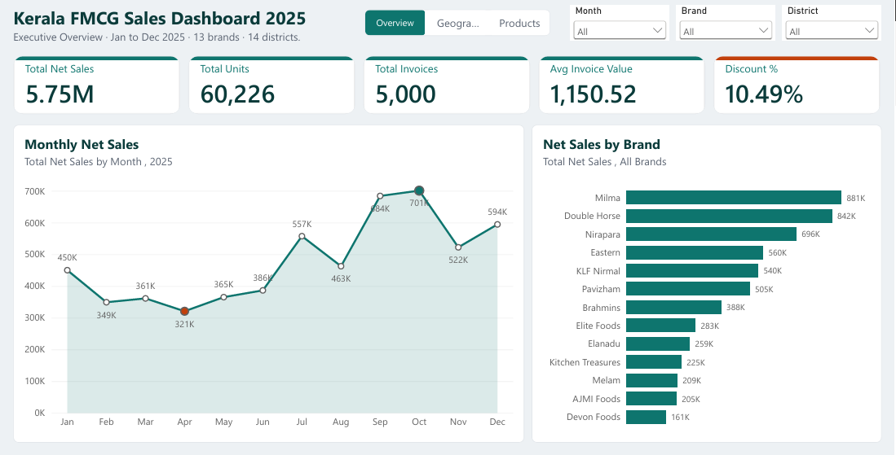
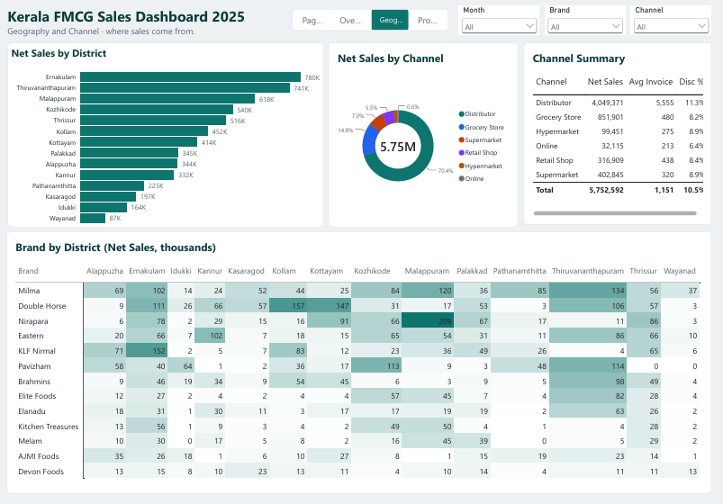
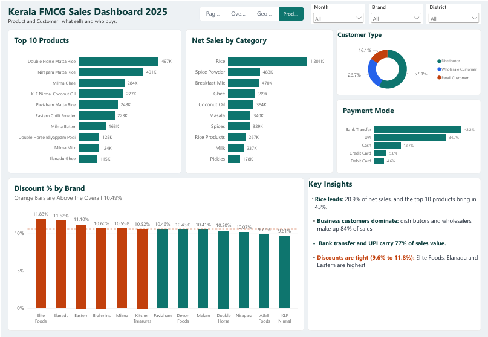

# Kerala FMCG Sales Analysis, 2025

> **Note:** The dataset used in this project is synthetic (simulated) and was generated for portfolio and learning purposes. It does not represent real sales figures, and the insights should not be read as findings about the actual Kerala FMCG market.

End-to-end sales analysis of a simulated Kerala FMCG dataset (5,000 invoices, 13 brands, 14 districts) using **Python, SQL (MySQL) and Power BI**.

## Objective
Find out which brands, products, districts, channels, customers and months drive sales, and where discounts and growth opportunities lie.

## Project Structure
```
kerala-fmcg-sales-analysis/
├── README.md
├── data/
│   ├── kerala_fmcg_sales_2025.csv       (raw data)
│   └── kerala_fmcg_clean.csv            (cleaned data)
├── notebooks/
│   └── FMCG_Sales.ipynb                 (Python analysis)
├── reports/
│   └── FMCG_Sales_Report.pdf            (notebook as PDF)
├── sql/
│   └── fmcg_analysis.sql                (MySQL queries)
└── powerbi/
    ├── Kerala_FMCG_Dashboard.pbix
    ├── Kerala_FMCG_Dashboard.pdf
    └── screenshots/
        ├── page1_overview.png
        ├── page2_geography.png
        └── page3_products.png
```

## Dataset
- **Period:** 1 Jan 2025 to 31 Dec 2025
- **Size:** 5,000 rows, 15 columns (20 after cleaning)
- **Key columns:** Invoice_ID, Date, Brand, Product, Category, District, Sales_Channel, Units_Sold, Unit_Price_INR, Gross_Sales_INR, Discount_Percentage, Discount_Amount_INR, Net_Sales_INR, Customer_Type, Payment_Mode

## Data Cleaning
- No missing values and no duplicate invoice IDs.
- Gross sales, discount amount and net sales validated with 0 mismatches.
- Fixed date parsing: `dayfirst=True` produced 2,984 invalid dates, so the format was set explicitly to `%Y-%m-%d` (0 invalid dates).
- Added Year, Month_Num, Month_Name, Quarter and Weekday columns.

## Key Findings
- **Overall:** Net sales of Rs 57.53 lakh, 60,226 units, and Rs 6.74 lakh in discounts (10.5% of gross sales).
- **Brands:** Milma (15.3%) and Double Horse (14.6%) bring in about 30% of net sales. The top 5 brands account for about 61%.
- **Products and categories:** Rice is the top category (20.9%). The top 10 products make up about 43% of sales.
- **Districts:** Ernakulam (13.6%) and Thiruvananthapuram (12.9%) lead. Wayanad is lowest (1.5%).
- **Seasonality:** Q4 is the strongest quarter (31.6%). October is the best month and April the lowest.
- **Channels:** Distributors generate about 70% of net sales. Online is only about 0.6%.
- **Customers and payments:** Distributors and wholesale customers make up about 84% of sales. UPI is most used by invoice count (44%), while bank transfers carry the most value (42%).
- **Discounts:** Distributor invoices get the highest rate (11.3%), online the lowest (6.4%).

## Recommendations
- Develop online and modern-trade channels, which are very small compared with distributors.
- Plan stock and promotions for the Sep to Dec peak, and investigate the April low.
- Review distribution in Wayanad, Idukki and Kasaragod.
- Protect top brands and categories, and review discount levels by customer type.

## Python Analysis
- Notebook: [notebooks/FMCG_Sales.ipynb](notebooks/FMCG_Sales.ipynb)
- Full report as PDF: [reports/FMCG_Sales_Report.pdf](reports/FMCG_Sales_Report.pdf)
- Libraries: pandas, NumPy, Matplotlib

## SQL Analysis
MySQL 8.0 queries on the cleaned `sales` table (loaded from `kerala_fmcg_clean.csv`), in [sql/fmcg_analysis.sql](sql/fmcg_analysis.sql).

| Query | What it answers |
|---|---|
| Q1 | Overall KPIs: invoices, units, gross/net sales, discount % |
| Q2 | Brand performance with sales share % and rank |
| Q3 | Monthly net sales, month-on-month growth and running total |
| Q4 | District performance with share % and rank |
| Q5 | Top 3 products per brand |
| Q6 | Best-selling brand in each district |
| Q7 | Channel performance, average invoice value and discount % |
| Q8 | Brands with a discount % above the overall average |
| Q9 | Pareto analysis: cumulative share of net sales by product |
| Q10 | Data quality checks (duplicates, nulls, calculation errors) |

**Views for Power BI:** `vw_monthly_sales`, `vw_brand_summary`, `vw_district_summary`, `vw_channel_summary`
**Techniques:** CTEs, window functions (RANK, ROW_NUMBER, LAG, running totals), subqueries, CASE, views.

## Power BI Dashboard (3 pages)

**Page 1: Overview**


**Page 2: Geography**


**Page 3: Products**


Downloads: [Dashboard PDF](powerbi/Kerala_FMCG_Dashboard.pdf) | [Power BI file (.pbix)](powerbi/Kerala_FMCG_Dashboard.pbix)

## Tools
Python (pandas, NumPy, Matplotlib), SQL (MySQL 8.0), Power BI, Jupyter Notebook

## Author
**Jasna KY**, Data Analyst [LinkedIn](https://www.linkedin.com/in/jasna-ky-3a04623a7) | [GitHub](https://github.com/Jasnaky)
